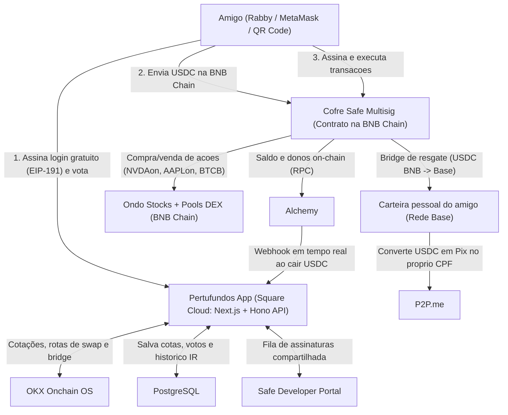

# Como Funciona o Ecossistema do Pertufundos (Sem Mistério)

Configurar várias plataformas de uma vez parece confuso no começo, mas **cada serviço tem exatamente um trabalho específico**. Este documento explica o sistema inteiro de forma simples: por que tanta peça existe, o que cada subplataforma faz e como tudo conversa do depósito até o saque em Pix.

---

## 1. A Ideia Central em 30 Segundos

Num clube tradicional entre amigos, uma pessoa teria que receber o dinheiro de todo mundo no próprio CPF e operar na própria corretora — misturando patrimônio, gerando dor de cabeça no Imposto de Renda e exigindo confiança cega em uma única pessoa.

No **Pertufundos**, o desenho separa **quem guarda o dinheiro**, **quem aprova as ordens**, **quem calcula as cotas** e **quem saca em reais**:

* **Nenhuma chave privada fica no servidor** (mesmo se o servidor da Square Cloud for invadido ou desligado, ninguém rouba 1 centavo do cofre).
* **Ninguém movimenta dinheiro sozinho** (as ordens dependem do quórum de assinaturas na blockchain).
* **Cada amigo entra e sai pela cota justa (NAV)** sem diluir o lucro de ninguém, e saca em **Pix no próprio CPF**.

---

## 2. Por que Duas Redes Blockchains (`BNB Chain` e `Base`)?

O sistema usa duas redes EVM diferentes porque cada uma resolve melhor metade do problema:

1. **BNB Smart Chain (`Chain ID 56`) — Onde o clube funciona:**
   * Taxas de transação de poucos centavos (pagas em `BNB`).
   * É onde o contrato da **Safe Multisig** mora, onde o **`USDC`** do caixa fica guardado (`18` decimais na BSC) e onde as **ações tokenizadas da Ondo (`NVDAon`, `AAPLon`, `MSFTon`, `QQQon`, etc.)** e criptos (`BTCB`, `ETH`, `PAXG`) têm liquidez para compra e venda.
2. **Base (`Chain ID 8453`) — A porta de saída para o Pix:**
   * Na hora que um amigo pede resgate, o cofre manda **`USDC` na rede Base** (`6` decimais) direto para a carteira pessoal daquele amigo, porque é a rede usada para converter em **Pix** via **P2P.me**.

*(O seu endereço `0x...` da Rabby é o mesmo nas duas redes — você não precisa criar um endereço diferente para a Base.)*

---

## 3. O Motivo de Cada Subplataforma que Você Configurou

| Subplataforma | Papel no Ecossistema | O que quebra se não tiver? |
| :--- | :--- | :--- |
| **Rabby / MetaMask** | Sua carteira pessoal (identidade e assinatura) | Você não consegue logar, votar nem assinar na Safe |
| **Reown (WalletConnect)** | Gera o QR Code para conectar pelo celular | Navegadores sem extensão da Rabby não conseguem conectar |
| **Safe Multisig** | O cofre compartilhado na blockchain | Não existe custódia coletiva sem CPF único |
| **Safe Developer Portal** | Fila compartilhada de assinaturas pendentes | Um amigo não enxerga a transação que o outro propôs assinar |
| **Alchemy (RPC + Webhook)** | Lê a blockchain e avisa quando cai depósito | O site não lê saldos direito e não credita aportes automático |
| **OKX Onchain OS** | Cotações ao vivo + rota de compra/venda/bridge | Fica travado em modo simulação (sem preço real nem swap real) |
| **Square Cloud + PostgreSQL** | Roda o site/API 24h e guarda cotas, votos e IR | Sem servidor e banco, não há painel nem registro histórico |
| **Ondo Finance & P2P.me** | Ativos tokenizados (Ondo) e saque Pix (P2P.me) | *(Não exigem chave no servidor)* |

Abaixo, o detalhe de cada uma:

---

### 3.1 — Carteira Individual (`Rabby Wallet` / `MetaMask`)
* **O que é:** A carteira pessoal de cada amigo (EOA — conta tradicional com *seed phrase* / chave privada).
* **Por que precisa:** Ela é a sua **identidade** no Pertufundos. Quando você entra no site e clica em **Assinar Login**, a assinatura criptográfica prova que você é dono daquele endereço `0x...` sem precisar de senha, e-mail nem taxa de gás.
* **Por que deixar `BNB` (~US\$ 2–5) nela:** Toda vez que você cria a Safe ou clica em **Executar** na última assinatura de uma proposta na BNB Chain, a rede cobra alguns centavos de gás em `BNB`.
* **Por que não usar a Smart Account da Picnic como dona da Safe:** A Picnic cria uma *Smart Account* (contrato inteligente com Passkey), não uma carteira EOA simples. O login do Pertufundos valida assinatura EOA padrão e a Safe na BSC precisa de donos EOA que assinem e paguem gás em `BNB`.

---

### 3.2 — Reown / WalletConnect (`NEXT_PUBLIC_WALLETCONNECT_PROJECT_ID`)
* **O que é:** O protocolo padrão de mercado para conectar uma carteira do **celular** a um site aberto no **PC** via QR Code.
* **Por que precisa:** Sem ele, o site só consegue falar com extensões instaladas no próprio navegador do PC (Chrome/Brave). Como você usa um navegador sem extensão da Rabby, o Project ID do Reown permite clicar em **Conectar Carteira**, abrir o QR Code na tela e aprovar tudo direto pelo app da Rabby/MetaMask no celular.
* **Onde fica no código:** [wagmi-config.ts](file:///c:/Users/vinil/Documents/pertufundos/apps/web/src/lib/wagmi-config.ts) e [WalletConnectQrModal.tsx](file:///c:/Users/vinil/Documents/pertufundos/apps/web/src/components/WalletConnectQrModal.tsx).

---

### 3.3 — Safe Multisig (`app.safe.global` — `SAFE_ADDRESS` e `SAFE_THRESHOLD`)
* **O que é:** O **cofre inteligente** implantado na **BNB Smart Chain** (no seu caso, o contrato `0x9742496F4CCd3BbA4465D3f45d99c89B28e02B7d`).
* **Por que precisa:** É aqui que o dinheiro do clube realmente fica guardado. A Safe tem uma lista de donos (*owners* / *signers*) e um quórum mínimo (*threshold*, ex.: `3 de 5`).
  * Ninguém saca ou troca nada sem o mínimo de assinaturas exigido pelo contrato na blockchain.
  * Ao cadastrar um participante no Pertufundos, o backend consulta diretamente `getOwners()` nesse contrato para confirmar quem realmente faz parte da multisig.

---

### 3.4 — Safe Developer Portal (`developer.safe.global` — `NEXT_PUBLIC_SAFE_API_KEY`)
* **O que é:** O serviço oficial da Safe que guarda a **fila de transações pendentes de assinatura** (*Safe Transaction Service*).
* **Por que precisa:** Quando o Amigo 1 cria e assina uma transação na Safe (ex.: *"Comprar US\$ 500 de NVDAon"*), ela ainda não vai para a blockchain porque faltam as assinaturas dos Amigos 2 e 3. O serviço da Safe guarda essa assinatura parcial na nuvem para os outros amigos abrirem o painel e assinarem também.
* **Por que precisa da API Key:** Sem a chave JWT configurada em `NEXT_PUBLIC_SAFE_API_KEY`, a API pública da Safe bloqueia requisições por limite de tráfego (*rate limit*).
* **Onde fica no código:** [safe-multisig.client.ts](file:///c:/Users/vinil/Documents/pertufundos/apps/web/src/lib/safe-multisig.client.ts).

---

### 3.5 — Alchemy (`BSC_RPC_URL`, `BASE_RPC_URL`, `ALCHEMY_WEBHOOK_SIGNING_KEY`)
A Alchemy faz **dois trabalhos diferentes** para o seu backend:

1. **RPC Estável (`BSC_RPC_URL` e `BASE_RPC_URL`):**
   * O backend não tem uma cópia da blockchain rodando localmente. Para perguntar à BNB Chain *"quanto de USDC e NVDAon tem dentro da Safe?"* ou *"quem são os donos da Safe?"*, ele precisa conversar com um nó RPC.
   * RPCs gratuitos públicos caem ou limitam requisições; o link da Alchemy com sua chave dá leitura rápida e estável.
   * *(O endpoint de Ethereum que aparece no cadastro inicial da Alchemy não é usado — o clube usa só BNB Chain e Base.)*
2. **Webhook de Depósitos em Tempo Real (`ALCHEMY_WEBHOOK_SIGNING_KEY`):**
   * Em vez de o servidor ficar perguntando toda hora *"caiu dinheiro novo?"*, você cadastra o endereço da **Safe** na Alchemy (*Address Activity*).
   * Assim que um amigo manda `USDC` para a Safe na BNB Chain, a Alchemy dispara um `POST` assinado (`X-Alchemy-Signature`) para `/api/v1/webhooks/alchemy`.
   * O backend valida a assinatura usando `ALCHEMY_WEBHOOK_SIGNING_KEY`, confere a transação na blockchain, calcula o valor da cota naquele instante e credita as cotas do amigo automaticamente (e avisa no Discord/Telegram, se configurado).

---

### 3.6 — OKX Onchain OS (`OKX_API_KEY`, `OKX_SECRET_KEY`, `OKX_API_PASSPHRASE`, `OKX_PROJECT_ID`)
* **O que é:** O agregador de liquidez DEX e *bridge* cross-chain da OKX Web3.
* **Por que precisa:** A Safe sozinha é apenas um cofre — ela não sabe quanto custa `NVDAon` nem qual pool tem o melhor preço para trocar `USDC` por `AAPLon`. A OKX faz três coisas para o Pertufundos ([okx-dex.gateway.ts](file:///c:/Users/vinil/Documents/pertufundos/apps/api/src/infrastructure/dex/okx-dex.gateway.ts)):
  1. **Preço ao vivo:** consulta o preço de cada ativo da carteira para calcular o **Patrimônio Total** e o **NAV da cota** em tempo real.
  2. **Rota de Swap (BNB Chain):** quando uma proposta é aprovada, gera os dados prontos (`Approve + Swap`) para comprar/vender o ativo com proteção contra *slippage* e *price impact* alto.
  3. **Rota de Bridge (BNB Chain $\rightarrow$ Base):** quando alguém pede resgate, monta a transação para mandar `USDC` da Safe (BNB Chain) direto para a carteira pessoal do cotista na rede **Base**.
* **Segurança:** As chaves da OKX **não têm acesso ao dinheiro**. A OKX só devolve os dados da transação montada; quem aprova e executa são os donos da Safe assinando nas próprias carteiras.

---

### 3.7 — Square Cloud + PostgreSQL (`server.mjs` + `DATABASE_URL`)
* **Square Cloud:** É o servidor que mantém tudo no ar 24/7 em **um único container** ([server.mjs](file:///c:/Users/vinil/Documents/pertufundos/server.mjs)):
  * Tudo que chega em `/api/v1/*` vai para o **Backend (Hono API)**;
  * Todo o resto vai para o **Frontend (Next.js)**.
* **PostgreSQL:** A blockchain guarda os saldos e a posse das moedas dentro da Safe, mas **não guarda** de quem é cada fração do cofre, qual foi o preço médio de entrada de cada amigo para o Imposto de Renda, nem os votos gratuitos antes de mandar para a Safe. Tudo isso fica salvo no banco PostgreSQL (`users`, `ledger_entries`, `nav_snapshots`, `proposals`, `proposal_votes`, `custom_tokens`).

---

### 3.8 — Ondo Finance & P2P.me (Sem Configuração de API)
* **Ondo Finance:** É quem emite as ações tokenizadas americanas (`NVDAon`, `AAPLon`, `MSFTon`, `QQQon`, `METAon`, `TLTon`, `GLDon`) na BNB Chain. Como elas já são negociadas livremente em pools de liquidez via OKX DEX, você não precisa abrir conta na Ondo.
* **P2P.me (`app.p2p.me`):** É o serviço descentralizado que cada amigo acessa individualmente no próprio navegador/celular quando recebe o `USDC` do resgate na rede **Base**, convertendo para **Pix no próprio CPF** sem passar dinheiro pelo servidor do clube.

---

## 4. O Ciclo Completo na Prática

### Fluxo 1 — Entrada e Aporte de um Amigo
1. O amigo tem uma carteira pessoal (`0x...`, ex.: Rabby) com um pouco de `BNB` e `USDC` na rede **BNB Smart Chain**.
2. Um administrador adiciona a carteira dele como *signer* na Safe (`app.safe.global`) e depois cadastra o apelido dele na aba **Aportes & Cotistas**.
3. O amigo envia `USDC` (rede BSC) para o endereço da Safe (`SAFE_ADDRESS`).
4. A **Alchemy** detecta o depósito via webhook e o backend emite as cotas correspondentes pelo **NAV** do momento.

### Fluxo 2 — Compra ou Venda de Ativos
1. No horário do pregão americano (para *spread* mínimo nas ações Ondo), um amigo abre uma proposta no Pertufundos (ex.: *"Comprar US\$ 500 de NVDAon"*).
2. O grupo vota no site (off-chain, zero gás).
3. Batido o quórum, a **OKX Onchain OS** gera a rota atualizada na hora e envia para a fila do **Safe Developer Portal**.
4. Os amigos assinam na Safe com suas carteiras; o último assinante clica em **Executar** e o contrato da Safe realiza a troca on-chain.

### Fluxo 3 — Resgate Individual em Pix
1. O amigo informa quantas cotas quer sacar na aba **Resgate & Pix**.
2. Se faltar `USDC` livre no caixa da Safe, o sistema calcula a venda proporcional exata dos ativos para não distorcer a carteira de quem continua no fundo.
3. Após aprovação e execução na Safe, a bridge via **OKX** envia `USDC` da **BNB Chain** para a carteira pessoal daquele amigo na rede **Base**.
4. O amigo entra no **[app.p2p.me](https://app.p2p.me)** com sua carteira na rede **Base** e converte para **Pix** na própria conta bancária.

### Fluxo 4 — Imposto de Renda Individual
* Na aba **Meu Imposto de Renda**, cada amigo autenticado exporta **apenas o próprio CSV** (outro participante não consegue ver seus dados), já com custo de aquisição ponderado por aporte e ganho de capital realizado apenas nos resgates.

---

## 5. Guia Rápido de Diagnóstico ("Deu Erro, Onde Olho?")

| Sintoma | O que conferir |
| :--- | :--- |
| **"Provider not found" / sem botão QR Code** | Verifique se `NEXT_PUBLIC_WALLETCONNECT_PROJECT_ID` (do `cloud.reown.com`) está configurado na Square Cloud. |
| **Erro ao "Entrar no Clube" (`getOwners` / acesso negado)** | `SAFE_ADDRESS` deve ser o endereço do **contrato Safe** na BNB Chain (não uma carteira pessoal) e sua carteira precisa estar na lista de *owners* da Safe. |
| **Erro ao propor ou assinar na fila da Safe** | Confira `NEXT_PUBLIC_SAFE_API_KEY` e se a carteira conectada está na rede **BNB Smart Chain (56)**. |
| **Preços simulados ou erro em cotação/swap** | Confira `OKX_API_KEY`, `OKX_SECRET_KEY`, `OKX_API_PASSPHRASE` e `OKX_PROJECT_ID`. |
| **Aporte enviado para a Safe não apareceu automático** | Confira se o webhook **Address Activity** na Alchemy está na rede **BNB Smart Chain Mainnet**, apontando para `https://SEU-APP.squareweb.app/api/v1/webhooks/alchemy`, monitorando o endereço exato da Safe e com `ALCHEMY_WEBHOOK_SIGNING_KEY` igual no servidor. |
